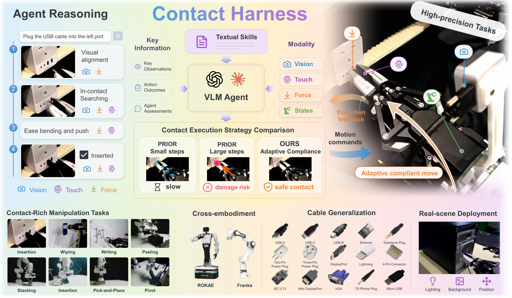
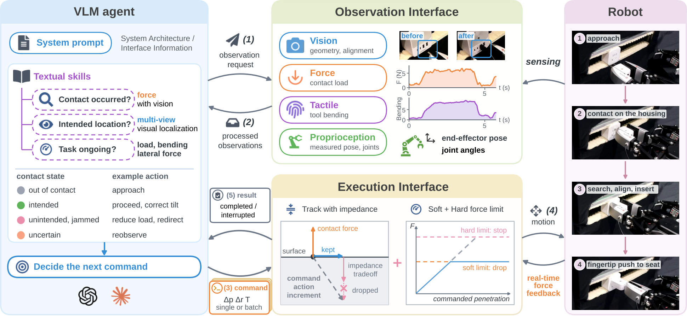
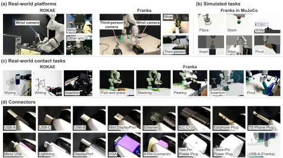

<div align="center">

# Contact Harness: Enabling VLM Agents to Perform Contact-Rich Manipulation

[](https://arxiv.org/abs/2611.29377)
[](https://ntumars.github.io/ContactHarness/paper.pdf)
[](https://ntumars.github.io/ContactHarness/)
[](https://github.com/NTUMARS/Contact-Harness)
[](https://huggingface.co/datasets/ntumars/Contact-4)
[](LICENSE)

**Shilin Shan**<sup>\*†</sup> · **Yuxuan Hu**<sup>\*</sup> · **Chuhao Zhou**<sup>\*</sup> · Yimeng Dong · Bohan Hou · Jiaqi Bai · Boyu Ma · Jiahua Dong · **Jianfei Yang**<sup>‡</sup>

MARS Lab, Nanyang Technological University

<sup>\*</sup>Equal contribution &nbsp; <sup>†</sup>Project lead &nbsp; <sup>‡</sup>Corresponding author

<picture><source media="(prefers-color-scheme: dark)" srcset="docs/assets/mars-lab-white.png"></picture> &nbsp;&nbsp;&nbsp; 

</div>

<p align="center">

</p>

> [!NOTE]
> **This repository holds the project page.** All website files are in `docs/`: `index.html` and four sub-pages, with the robot
> videos in `media/` and figures in `assets/` within that folder. The code and the textual skills are in
> [NTUMARS/Contact-Harness](https://github.com/NTUMARS/Contact-Harness).

## 📰 News

- 📄 **Paper**: [arXiv:2611.29377](https://arxiv.org/abs/2611.29377), [PDF](https://ntumars.github.io/ContactHarness/paper.pdf), with the supplementary material.
- 🌐 **Project page**: <https://ntumars.github.io/ContactHarness/>. This repository is its source.
- 💻 **Code and textual skills**: [NTUMARS/Contact-Harness](https://github.com/NTUMARS/Contact-Harness).
- 🤗 **Contact-4 demonstrations**: [ntumars/Contact-4](https://huggingface.co/datasets/ntumars/Contact-4) on Hugging Face.

## 💡 Overview

Contact Harness uses reusable textual skills to help a frozen VLM interpret visual, force and tactile feedback during
contact. Compliant execution adjusts motion using real-time force feedback between the agent's decisions, without model
fine-tuning or task demonstrations.

- 🚫 **No fine-tuning, no demonstrations.** A frozen VLM agent (GPT-6 Astra by default) controls the robot zero-shot.
- 🖐️ **Vision, force and touch.** Textual skills tell the agent how to read each signal by its physical meaning,
  together with the task phase and the visual evidence.
- 🛡️ **Compliant execution.** Impedance control with a soft force limit regulates motion within each command, so contact
  is handled safely between the agent's decisions.
- 🤖 **One harness, several robots.** The same harness runs on a Rokae arm, a Franka arm and a simulated Franka in MuJoCo.

## 🧠 How it works

<p align="center">

</p>

1. **Observe.** The agent requests the observations it needs: camera images, the six-axis wrist wrench, tactile readings
   and proprioception.
2. **Assess.** Guided by the textual skills, it judges the contact state, for example aligned, in contact, jammed or seated.
3. **Act.** It issues one command or a short batch, each a target displacement with an execution duration, and can raise
   or lower the soft force limit for the current phase.
4. **Execute compliantly.** The harness splits each command into small increments, drops any increment that would push
   load past the soft limit, and tracks the reference pose with impedance control.
5. **Report back.** The accepted reference poses and the measured final poses return to the agent for its next decision.

The observation interface, command interface and compliant execution are shared across all tasks and robots. The
textual skills combine a common contact-state assessment procedure with task-specific rules.

## 🦾 Experimental setup

<p align="center">

</p>

| Platform | Sensing |
| --- | --- |
| **Rokae** 7-DoF arm, DH-Robotics AG-95 gripper | Two wrist cameras and a head camera; six-axis wrist wrench; a Daimon DM-Tac W2 tactile sensor on each finger |
| **Franka** arm | A wrist camera and an external camera; force from the robot's torque estimates (no tactile sensors) |
| **Franka in MuJoCo** | Visual, force and tactile observations, with camera placements matching the real setup |

## 📊 Results

All real-robot runs use GPT-6 Astra with high reasoning effort, 10 trials per task or connector. Time and decisions are
averaged over successful trials; force is the median over trials of the peak contact force.

### Connector insertion on the Rokae arm: 136/150 (90.7%) with a single insertion prompt

| Difficulty | Connectors (successes / 10) | Success |
| --- | --- | --- |
| 1 | TS Phone Plug 10 · Three-Pin Power Plug 10 · Two-Pin Power Plug 10 · IEC C13 10 · USB-A 10 | 100% |
| 2 | Ethernet 9 · USB-C 10 · Earphone Plug 10 · Lightning 9 · 4-Pin Connector 9 | 94% |
| 3 | USB-B 8 · VGA 9 · Mini DisplayPort 7 · DisplayPort 8 · Micro USB 7 | 78% |

Mean over the 15 connectors: 378 s, 23.1 decisions, 20.0 N peak force.

### Other real-robot tasks: 70/70

| Robot | Task | Success | Time (s) | Decisions | Force (N) |
| --- | --- | --- | --- | --- | --- |
| Rokae | Whiteboard wiping | 10/10 | 308 | 25.5 | 15.5 |
| Rokae | Writing | 10/10 | 413 | 42.6 | 10.8 |
| Franka | USB-A insertion | 10/10 | 203 | 15.1 | 18.4 |
| Franka | Vegetable peeling | 10/10 | 227 | 13.6 | 14.2 |
| Franka | Pivoting | 10/10 | 266 | 30.0 | 17.1 |
| Franka | Stacking (contact-free reference) | 10/10 | 284 | 15.3 | 11.2 |
| Franka | Pick-and-place (contact-free reference) | 10/10 | 357 | 18.1 | 7.5 |

These tasks use the fast mode.

### Insertion on a real PC

Lighting, background and socket position changed together, on the Rokae arm.

| Connector | Success | Time (s) |
| --- | --- | --- |
| IEC C13 | 10/10 | 377 |
| Earphone Plug | 9/10 | 269 |
| USB-A | 10/10 | 200 |

### Execution speed

| Robot and condition | Success | Time (s) |
| --- | --- | --- |
| Rokae IEC C13, high reasoning effort | 10/10 | 315 |
| Rokae IEC C13, fast mode | 10/10 | 183 |
| Rokae IEC C13, fast mode with memory | 10/10 | 96 |
| Franka USB-A, fast mode with memory | 10/10 | 147 |

With memory, the 10 trials run in one agent conversation, with manual resets between trials.

### Simulation: six tasks with a Franka arm in MuJoCo

Ten trials per task. VLM-based baselines use GPT-6 Astra; training-based policies are fine-tuned on 50 human
demonstrations per task.

| | Method | Place | Stack | Insert | Wipe | Write | Pivot | Mean |
| --- | --- | --- | --- | --- | --- | --- | --- | --- |
| **Ours** | **Contact Harness (GPT-6 Astra)** | 10/10 | 10/10 | 8/10 | 10/10 | 10/10 | 10/10 | **96.7%** |
| | Contact Harness (Claude Fable 5.1) | 10/10 | 10/10 | 9/10 | 10/10 | 10/10 | 10/10 | 98.3% |
| | Contact Harness (Claude Fable 5.2) | 10/10 | 10/10 | 9/10 | 10/10 | 10/10 | 10/10 | 98.3% |
| Training-based | ForceVLA | 10/10 | 8/10 | 2/10 | 6/10 | 6/10 | 9/10 | 68.3% |
| | π0.5 + force | 8/10 | 6/10 | 1/10 | 4/10 | 8/10 | 10/10 | 61.7% |
| | π0.5 | 5/10 | 6/10 | 0/10 | 3/10 | 5/10 | 9/10 | 46.7% |
| | CompliantVLA | 9/10 | 6/10 | 0/10 | 3/10 | 0/10 | 8/10 | 43.3% |
| Code as policies | GenCHiP (goal only) | 9/10 | 8/10 | 0/10 | 1/10 | 2/10 | 0/10 | 33.3% |
| | GenCHiP + our prompt skill | 5/10 | 5/10 | 0/10 | 0/10 | 0/10 | 0/10 | 16.7% |
| | CaP-X | 5/10 | 3/10 | 1/10 | 4/10 | 1/10 | 0/10 | 23.3% |
| | CaP-X + wrist camera | 2/10 | 1/10 | 0/10 | 6/10 | 1/10 | 0/10 | 16.7% |
| | CaP-X + our prompt skill | 0/10 | 0/10 | 0/10 | 0/10 | 0/10 | 0/10 | 0.0% |
| Harness | Show-Harness | 9/10 | 1/10 | 0/10 | 0/10 | 0/10 | 0/10 | 16.7% |

Place and Stack are contact-free references. Stack comes from robosuite; Insert is modified from the Isaac Lab Factory
PegInsert task with added press-fit resistance.

### Ablation: four simulated contact tasks

| Configuration | Insert | Wipe | Write | Pivot | Mean |
| --- | --- | --- | --- | --- | --- |
| **Contact Harness (full)** | 8/10 | 10/10 | 10/10 | 10/10 | **95.0%** |
| w/o force observations | 7/10 | 7/10 | 9/10 | 10/10 | 82.5% |
| w/o textual skills | 0/10 | 0/10 | 9/10 | 8/10 | 42.5% |
| w/o compliance & soft limit | 0/10 | 9/10 | 10/10 | 6/10 | 62.5% |

The force-observation ablation hides the wrench readings from the agent only; compliant execution and the force limits
still use them. Without compliance and the soft limit, motions run under stiff position control with no force limit.

## 🚀 Setup

The code and the textual skills live in [NTUMARS/Contact-Harness](https://github.com/NTUMARS/Contact-Harness). The
quickest way to set up either environment is to let a terminal coding agent (Claude Code, Codex, ...) do it from one
prompt. That repository provides a recommended prompt for each environment, together with the points our own runs had
to work out:

| Environment | Recommended prompt | Requirements |
| --- | --- | --- |
| Contact-4 simulation | [`contact4/RECOMMENDED_PROMPT.md`](https://github.com/NTUMARS/Contact-Harness/blob/main/contact4/RECOMMENDED_PROMPT.md) | Linux with an NVIDIA GPU (EGL), `ffmpeg`, Python 3.10 |
| Franka real robot, single machine | [`harness/franka/RECOMMENDED_PROMPT.md`](https://github.com/NTUMARS/Contact-Harness/blob/main/harness/franka/RECOMMENDED_PROMPT.md) | Franka control PC with an RT kernel, ROS Noetic, franka_ros, one RealSense camera |

Fill in the `<...>` fields, open the agent at the repository root (simulation) or on the control PC (real robot), paste
the prompt, and the agent installs the dependencies, starts the services and runs a first check.

The detailed deployment instructions are in the README of each environment:
[`contact4/README.md`](https://github.com/NTUMARS/Contact-Harness/blob/main/contact4/README.md) for the simulation and
[`harness/franka/README.md`](https://github.com/NTUMARS/Contact-Harness/blob/main/harness/franka/README.md) for the
real robot. The Contact-4 demonstrations are on Hugging Face:
[ntumars/Contact-4](https://huggingface.co/datasets/ntumars/Contact-4).

## 🗂️ About this repository

```text
ContactHarness/
├── docs/          # Complete project website
├── README.md
├── LICENSE
└── .gitignore
```

GitHub Pages: **Settings → Pages → Deploy from a branch → main → /docs → Save**.
The public address remains https://ntumars.github.io/ContactHarness/.

| Page | Contents |
| --- | --- |
| `docs/index.html` | Overview: demo videos, the real-robot task gallery, the trial player and a summary of results |
| `docs/experiments.html` | Real-robot experiments: one trial per task or connector with the agent process, and six trials side by side |
| `docs/method.html` | The contact loop and the experimental setup |
| `docs/results.html` | Full real-robot, simulation and ablation results, with charts and tables |
| `docs/paper.html` | Paper and supplementary material |

- Videos are in `docs/media/videos/` (H.264, fast start for streaming); posters in `docs/media/posters/`.
- Time-lapse clips are encoded at 15× and labelled as time-lapse on the page; the process clock shows elapsed real time.
- Every path is relative, so the page works from any subfolder, including GitHub Pages.
- To preview locally, serve the website folder with any static file server, for example `python -m http.server 8000 --directory docs`, and open
  <http://localhost:8000/>.

## 🙏 Acknowledgements

The simulation experiments run in [MuJoCo](https://mujoco.org/). The Stack task comes from
[robosuite](https://github.com/ARISE-Initiative/robosuite), and the Insert task is modified from the Factory PegInsert
task in [Isaac Lab](https://github.com/isaac-sim/IsaacLab).

## 📄 License

The original source code and documentation of Contact Harness are licensed under the [Apache License 2.0](LICENSE).
Third-party code, simulators, assets and model weights keep their own licenses.

## 📝 Citation

[arXiv:2611.29377](https://arxiv.org/abs/2611.29377)

```bibtex
@misc{shan2026contactharness,
  title         = {{Contact Harness: Enabling VLM Agents to Perform Contact-Rich Manipulation}},
  author        = {Shan, Shilin and Hu, Yuxuan and Zhou, Chuhao and Dong, Yimeng and Hou, Bohan and Bai, Jiaqi and Ma, Boyu and Dong, Jiahua and Yang, Jianfei},
  year          = {2026},
  eprint        = {2611.29377},
  archivePrefix = {arXiv},
  primaryClass  = {cs.RO},
  url           = {https://arxiv.org/abs/2611.29377}
}
```
